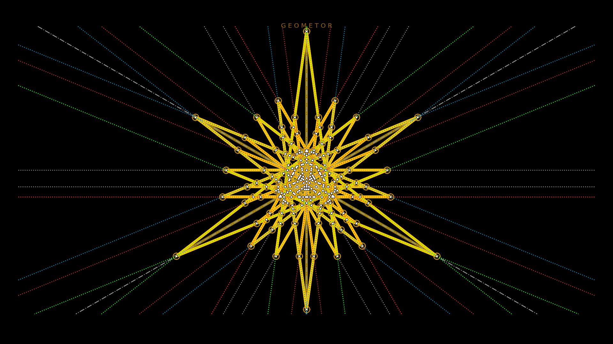

GEOMETOR • phyllotaxis
======================

**Visit the Online Archive:** https://geometor.github.io/phyllotaxis/

**Phyllotaxis • Golden-angle botanical morphogenesis & 2D/3D WebGL studios**

Mission
-------

``geometor/phyllotaxis`` is part of the interconnected `GEOMETOR <https://geometor.com>`_ semantic digital archive. It models the mathematical and geometric laws of botanical growth—from planar Vogel capitula and golden-angle divergence (:math:`\Phi = 2\pi(1 - 1/\phi) \approx 137.508^\circ`) to recursive 3D meristem path propagations. Through embedded 60 FPS HTML5 Canvas and Three.js WebGL laboratories, it liberates dynamic morphogenetic processes from static diagrams into interactive, verifiable simulations across the GEOMETOR corpus.

Capabilities & Interactive Docs
-------------------------------

- **`Phyllotaxis Interactive Studio <https://geometor.github.io/phyllotaxis/>`_** — Overview of botanical geometry models and real-time interactive laboratories.
- **`2D Apical Meristem & Parastichy Studio <https://geometor.github.io/phyllotaxis/demos/meristem_2d.html>`_** — Live planar growth, rational Fibonacci convergent scrubbing, and stroboscopic zoetrope rotation.
- **`3D Node-as-Path & Recursive Meristem Studio <https://geometor.github.io/phyllotaxis/demos/propagation_3d.html>`_** — Interactive Three.js WebGL visualization of 3D vascular trajectories and recursive branching meristems.
- **`Mission & Mathematical Principles <https://geometor.github.io/phyllotaxis/mission/>`_** — Exact symbolic divergence angles, Lucas sequences, and the divine proportion in nature.
- **`Usage & Python API <https://geometor.github.io/phyllotaxis/usage/>`_** — CLI tools and programmatic generation of 3D meristem trees.

Repository Contents
-------------------

- ``docsrc/`` — RST documentation and interactive WebGL/Canvas templates compiled by `PHOTON publish <https://github.com/photon-platform/publish>`_.
- ``src/geometor/phyllotaxis/`` — Symbolic angles, planar Vogel generators, 3D path builders, and analysis modules.

Local Build & Verification
--------------------------

.. code-block:: bash

   publish build
   uv run --no-sync pytest

Part of the GEOMETOR Knowledge Archive
--------------------------------------

Explore all **74 Book Codices** and **11 Mathematical Catalogs** at https://geometor.com/books/.
